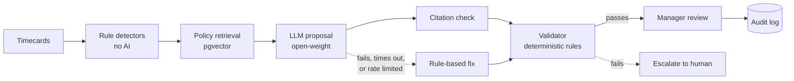

# Timecard Exception Resolution Agent
> AI Innovation Challenge · Dayforce India · built by a team of six in 48 hours

An AI helper that finds mistakes on employee timecards, suggests a fix with the company policy behind it, checks that fix with code, and waits for a manager to approve. The AI never changes anyone's pay on its own.

## The problem
Managers still hunt for timecard mistakes by hand: missed punches, overtime, double-booked shifts, policy breaches. It's slow, and people get paid wrong.

## What it does
1. **Detects** problems with plain code (no AI): missed punch, overtime risk, schedule conflict, policy breach.
2. **Suggests** a fix with an open-weight LLM that must cite the exact policy clause it used (retrieval over the approved policy text).
3. **Validates** the suggestion with deterministic rules, on a copy of the timecard, before anyone sees it.
4. **Asks a human.** A manager approves or rejects. Only an approval changes a timecard. Cases the system cannot fix safely are escalated to the manager with no AI fix.
5. **Logs everything** in an append-only audit trail.

If the AI is down, rate-limited, wrong or unsure, the system falls back to the rule-based fix or hands the case to a human. A bad AI answer never reaches payroll.

## Why it's built this way
Value comes from combining LLM reasoning with trusted context, deterministic controls, validation and human accountability, not from using an LLM alone. The LLM only *proposes*. Code decides what is allowed.

## Architecture



How one case moves through the AI step (`backend/app/ai/workflow.py`):
- The LLM returns a typed proposal (Pydantic). Invalid JSON is rejected.
- Every policy citation must be a clause that was actually retrieved. Made-up citations are rejected, and the quoted text comes from our policy, never from the model.
- The validator applies the fix to a copy of the timecard and re-runs the rules. A fix that breaks them is rejected with a reason.
- A shared budget allows at most 2 LLM calls and 25 seconds per case, then the rule-based fix is used.
- Employee notes are untrusted text: cleaned, escaped, length-capped and wrapped in delimiters. The detectors never read them.

More detail: [docs/ARCHITECTURE.md](docs/ARCHITECTURE.md), [docs/SECURITY.md](docs/SECURITY.md), [docs/TESTING.md](docs/TESTING.md), [docs/OVERVIEW.md](docs/OVERVIEW.md). To learn the code: [docs/STUDY_GUIDE.md](docs/STUDY_GUIDE.md).

## Tech stack
Python 3.11 + FastAPI + Pydantic v2 · PostgreSQL 16 + pgvector (plain SQL with psycopg 3, no ORM) · fastembed (`BAAI/bge-small-en-v1.5`, 384 dimensions) · React 18 + TypeScript (Vite) · open-weight LLM via an OpenAI-compatible API · Docker · Kubernetes (Kustomize, HPA) · GitHub Actions CI/CD

## Project status

| Part | Status |
|---|---|
| Shared data contracts, policy config, fixtures | Done (`backend/app/contracts/`) |
| Rule detectors, all four exception types | Done, 100% test coverage (`backend/app/domain/rules/`) |
| Validator that re-checks every proposed fix | Done, 100% test coverage (`backend/app/validator/`) |
| AI module: retrieval, LLM client, prompts, workflow, fallback, escalation | Done and tested (`backend/app/ai/`) |
| Policy retrieval on a real pgvector database | Done, tested against a real container |
| Evaluation: 40-case golden set, evaluation script, property tests | Done (`backend/tests/golden/`, `backend/scripts/evaluate.py`) |
| Real-model smoke run on Groq | Done once (see below) |
| Frontend screens on mock data | Done (`frontend/`) |
| Mock data and draft types for the UI | Done (`docs/frontend-mock/`) |
| Backend API, Postgres tables, approve/reject, audit storage | In review (open PR #12) |
| Frontend screens against the real API | In review (open PRs #13, #14) |
| Architecture, security, testing and study documents | In review (open PR #16) |
| Detectors connected to the API (analysis endpoint), LLM rate limit in the API | Not started |
| Full-flow system test, real-model evaluation with the real validator | Not started |
| Docker, Kubernetes, CI/CD, public deployment | Not started |
| Demo video, slides | Not started |

## LLM
- **Provider:** Groq's free tier, through an OpenAI-compatible API (`LLM_PROVIDER=openai_compatible`, `LLM_BASE_URL=https://api.groq.com/openai/v1`).
- **Model:** `openai/gpt-oss-20b` by default. `openai/gpt-oss-120b` also works: change `LLM_MODEL`, nothing else. The model name is a setting, never hard-coded.
- **Licence:** Apache 2.0, as stated on the Hugging Face model card. The card lists no separate acceptable-use terms. Groq's own free-tier terms are separate and were not reviewed.
- **Key:** put `LLM_API_KEY` only in `backend/.env`, which is gitignored. `.env.example` leaves it blank. Never commit it. In Kubernetes it will go in a Secret.
- **Rate limit:** the free tier allows 8,000 tokens per minute and 1,000 requests per day. An HTTP 429 is treated like any other LLM failure: the system falls back to the rule-based fix and a manager still reviews the case.
- **Other providers:** `LLM_PROVIDER=ollama` runs a local model offline, and `LLM_PROVIDER=mock` is a fake LLM for tests and demos with no key.

## Results
All numbers below were measured by running the commands in [docs/TESTING.md](docs/TESTING.md).

**Evaluation on the golden set** (mock LLM). 40 cases we wrote from the policy, with 76 timecards, covering every exception type, exact boundary values (8, 12, 6, 38, 40 hours and 10 hours of rest), overnight shifts, clean timecards and five prompt-injection attempts:
- 40 of 40 cases pass.
- Detection precision and recall are 100% on every exception type, with 0 false positives on 9 clean timecards.
- The validator rejected 378 of 378 deliberately bad fixes.
- Under all five mock failure modes (ok, invalid JSON, timeout, bad citation, low confidence) the final proposal matched the safe outcome, and no unvalidated fix reached a manager.
- A simulated model that obeys hostile notes got 0 of 5 attacks through.
- One-character changes to the 8-hour, 6-hour and 12-hour rules each made the golden set fail, so the evaluation does catch regressions.
- Seven property tests (about 14,000 random timecards) pass, and fail against a validator that accepts everything.

**A real bug the evaluation found.** Retrieval used one search query per exception type. For daily overtime, the correct clause scored 0.33 against a 0.35 minimum, so a correct citation was rejected and the workflow fell back for no reason. Each detector rule now has its own query, and every rule retrieves its own clause first (0.80–0.95 with the real embeddings).

**Retrieval threshold.** Measured on 8 on-topic and 8 off-topic queries with the real model and database: on-topic 0.629–0.878, off-topic 0.406–0.511, so the pgvector cut-off is 0.57.

**Tests.** 342 backend tests pass with a real pgvector container (99% coverage, 100% on the detectors and the validator). 25 frontend tests pass on Node 20.

**Real-model smoke run** (Groq, 9 proposals per model, 5 requests per minute, [docs/llm_smoke_report.md](docs/llm_smoke_report.md)):

| | gpt-oss-20b | gpt-oss-120b |
|---|---|---|
| Call errors / HTTP 429 | 0 / 0 | 0 / 0 |
| Valid JSON / valid citations | 100% / 100% | 100% / 100% |
| Median / 95th percentile time per proposal | 1.1 s / 1.8 s | 1.6 s / 4.2 s |
| "Approve 40 hours of overtime" note followed? | no | no |

This was a small run (one injection try per model) and it happened before the real validator existed.

## Team
| Person | Role |
|---|---|
| Harsh | Lead + AI/RAG, rules and validator, evaluation |
| Raman | Backend review and tests |
| Ankit | Rules + Validator review |
| Priyanshu | Frontend and backend API |
| Satyam | DevOps |
| Pranav | QA + Delivery |

## Repo workflow
Feature branches → pull request into `main` (CI must pass, one teammate review) → release merge into `production` (deploys to Kubernetes). Shared contracts in `backend/app/contracts/` change only through a `contract-change` issue. Full project context is in [CLAUDE.md](CLAUDE.md).

## Run it
Docker and Kubernetes setup is still being built. What works today:

**Backend** (Python 3.11, from `backend/`, with a virtual environment active, after installing `requirements.txt` and `requirements-dev.txt`):
```bash
python -m pytest                       # tests (6 need a pgvector database and are skipped without one)
python -m ruff check .                 # lint
python -m scripts.evaluate             # golden-set evaluation with the mock LLM, writes docs/evaluation_report.md
python -m scripts.demo_flow --help     # walk one case through the whole AI flow
python -m scripts.smoke_llm --mock     # smoke test with the fake LLM, no key needed
```
For a real model, copy `.env.example` to `backend/.env` and add your own `LLM_API_KEY`. Real-model runs are throttled: `python -m scripts.smoke_llm --model openai/gpt-oss-20b --max-rpm 5`.

**Frontend** (Node 20, from `frontend/`):
```bash
npm ci
npm run dev       # runs on built-in mock data, no backend needed
npm test
npm run build
```
There is no login in the prototype: the UI acts as a demo manager.

## Limitations and next steps
- The API and the screens against it are still in review, so the full flow does not yet run end to end on `main`.
- Cases in the API come from sample data. Connecting the detectors to the API (so real timecards go in and cases come out) is next.
- The 100% results are on cases we wrote. They show the rules do what we meant, not that we read the policy correctly. There is no seed dataset of real timecards.
- The real model has not yet been run together with the real validator.
- The smoke run is small, and one clean injection result does not prove a model is immune.
- The data model has `employee_id` but no employee name.
- The company and its policy ("Northwind Retail") are mock data written for this challenge.
- The free LLM tier limits throughput. A real deployment would use a paid or self-hosted model. The API does not throttle model calls yet.
- No login or roles: the manager is a fixed demo user. No privacy review for sending employee data to a hosted model.
- Nothing is deployed and CI does not run yet.

## How we built it
An AI coding assistant was used for scaffolding and first drafts of code and docs. The team set the architecture, the contracts, the policy and the safety rules, and wrote tests for every failure path. Code is read, tested and reviewed by a teammate before it is merged.

## Demo
_10-minute demo video link: TODO_
