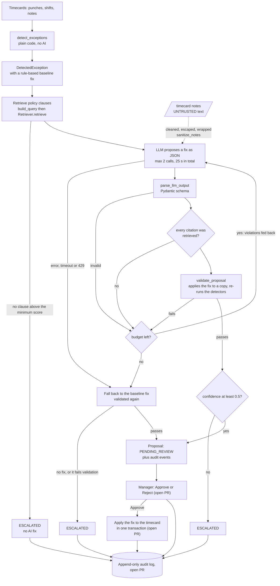

# Architecture

How a timecard problem is found, fixed on paper, checked, and shown to a manager, and where
each safety check sits. Written from the code on `main`. Anything that exists only in an open
pull request is marked **(open PR)** and is not described as done.

## The idea in one paragraph

Plain code finds the problem. An AI model is asked to suggest a fix, and is only allowed to
answer in a fixed shape and to cite policy text we gave it. Plain code then checks that fix
against the rules. If the model fails or is wrong, we use the fix the rules themselves
produced, or hand the case to a person. Only a manager's approval changes a timecard, and every
step is written down. The model is one untrusted step inside a frame of ordinary code.

## The whole flow

`run_workflow` returns the proposal and the list of audit events. It stores nothing itself.

## What each part does

| Part | Where | Job |
|---|---|---|
| Contracts | `backend/app/contracts/models.py`, `policy_config.py` | The shared data shapes (Pydantic) and the policy numbers. Everyone codes against these. |
| Policy text | `data/policies/time_attendance_policy.md` | The seven clauses `POL-TA-01` to `POL-TA-07`, split by heading into searchable chunks. |
| Detectors | `backend/app/domain/rules/detectors.py`, `analysis.py` | `detect_exceptions` finds missed punches, overtime risk, schedule conflicts and policy breaches. Pure functions. Never reads the notes. |
| Retrieval | `backend/app/ai/retrieval.py`, `embeddings.py`, `ingest.py` | `build_query` makes a search text for the rule that fired. `InMemoryRetriever` (keyword match) or `PgVectorRetriever` (embeddings, cosine similarity) return the matching clauses with a score. |
| Prompts | `backend/app/ai/prompts.py` | The system and user prompts, the shape the model must answer in (`LLMProposal`), and `sanitize_notes`. |
| Model client | `backend/app/ai/llm.py` | `OpenAICompatibleLLM` (any OpenAI-style endpoint, such as Groq) and `MockLLM` (a fake with failure modes, for tests). Model name, URL and key come from environment variables. |
| Workflow | `backend/app/ai/workflow.py` | `run_workflow` and `generate_proposal`: the state machine in the diagram. |
| Validator | `backend/app/validator/validator.py` | `validate_proposal`: re-checks every proposed fix with the real rules. |
| Settings | `backend/app/ai/settings.py` | Thresholds, retry budget (2 calls), deadline (25 s), `FALLBACK_CONFIDENCE`. All overridable by environment variables. |
| Scripts | `backend/scripts/` | `smoke_llm.py` (compare models), `demo_flow.py` (narrated run for the demo), `export_mock_data.py` (data and types for the frontend). |
| API and database | `backend/app/api`, `db`, `main.py` **(open PR #12)** | Cases, propose, approve, reject, audit, `/health`, `/metrics`, Postgres tables, append-only audit trigger. Not on `main` yet. |
| Frontend | `frontend/` | Manager screens. On `main` it runs on built-in mock data. Screens against the real API are in open PRs #12 to #14. |
| Evaluation | `backend/tests/golden`, `backend/scripts/evaluate.py` | A golden set of 40 cases and the script that writes `docs/evaluation_report.md` (PR #15, merged). |

## Where each safety check sits

| Check | Where in the flow | What it stops |
|---|---|---|
| Deterministic detection | `detect_exceptions`, before any AI | The model deciding what is wrong. It only ever sees an exception that code found. |
| Typed answer | `parse_llm_output` (`LLMProposal`) | Free text. A reply must be valid JSON in a fixed shape, with a rationale of at most 400 characters and a confidence between 0 and 1. |
| Notes are data | `sanitize_notes` plus the system prompt | Instructions hidden in the employee's notes. Control characters are removed, `<` and `>` are escaped (so the notes cannot close their own tag), the text is cut to 500 characters and wrapped in `<untrusted_notes>`. |
| Grounded citations | citation check in `run_workflow` | Invented policy. Every cited clause id must be one that was retrieved above the minimum score, and at least one is required. Quotes on the final proposal are copied from the retrieved text, never from model output. |
| Rule validation | `validate_proposal` | A wrong fix. It checks the kind of fix, what it touches, the 12 hour limit, the 10 hour rest rule, the break deduction, whether the problem is really gone, and whether a new violation appears. |
| Retry budget and deadline | top of the LLM loop | A slow or looping model. At most 2 model calls and 25 seconds per proposal, whatever mix of failures happens. |
| Fallback | `fallback()` in `run_workflow` | A model that is down, rate limited, or wrong. The rule-based fix is used, and it is validated too. |
| Escalation | `escalate()` in `run_workflow` | Cases with no safe automatic answer. The result is a `FLAG_FOR_MANAGER` fix with no changes. Reasons: `NO_POLICY_MATCH`, `NO_BASELINE_FIX`, `BASELINE_FIX_INVALID`, `LOW_CONFIDENCE`. |
| Human decision | manager Approve or Reject **(open PR #12)** | Any change without a person. Only an approval applies a fix, and an escalated case cannot be approved. |
| Audit trail | events from `run_workflow`; storage **(open PR #12)** | Hidden steps. Every step has an event. In the open PR the table is append-only (a database trigger rejects updates and deletes). |

## The two retrievers

- **Memory** (`RETRIEVER=memory`, the default): scores a clause by the share of query words it
  contains. No database, no model download. Used by tests and CI. Minimum score 0.35.
- **pgvector** (`RETRIEVER=pgvector`): embeds the query with `BAAI/bge-small-en-v1.5`
  (fastembed, 384 numbers) and searches the `policy_chunks` table by cosine similarity. Minimum
  score 0.57, chosen from a measured table (see `docs/OVERVIEW.md`). Load the policy with
  `python -m app.ai.ingest`.

## What runs where today

- On `main`: everything in the flow down to "Proposal: PENDING_REVIEW plus audit events", the
  scripts, the golden set and evaluation, the mock data for the frontend, and the frontend on mock
  data.
- In open PRs: the API and database (#12), the polished screens (#13), and Prettier and the OpenAPI
  file (#14).
- Not built: Docker images, Kubernetes manifests and CI. See Satyam's Docker and Kubernetes PRs
  when they exist; none exists yet.
